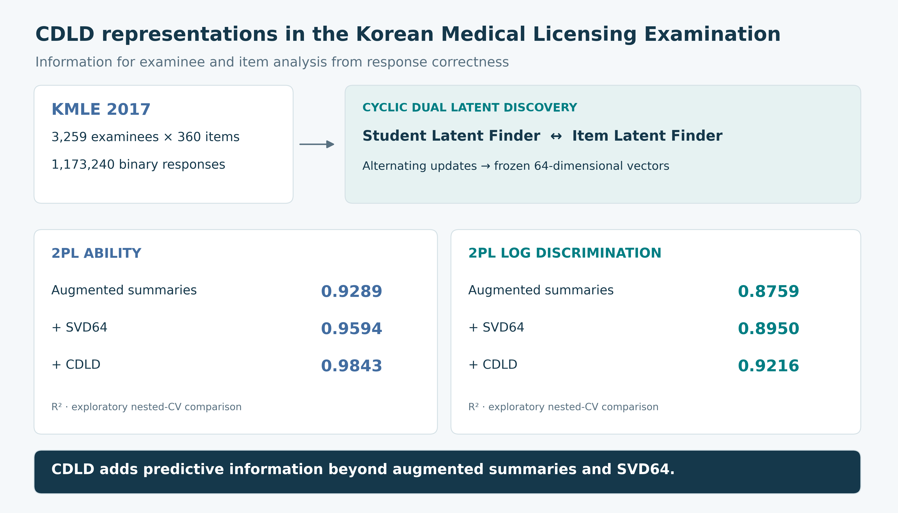

# CDLD in the Korean Medical Licensing Examination



**Predicting item response theory estimates and response correctness with cyclic dual latent discovery in the Korean Medical Licensing Examination: a methodological study**

Geonhee Yang and Dohyoung Rim

Code and final numerical results for the KMLE study. The current version contains KMLE analyses only. The repository URL is retained for stable links from the manuscript.

## Reproduce the paper tables and figures

```bash
python -m pip install -r requirements.txt
```

Open **paper_results.ipynb** from the repository root and select **Run All**. This single notebook contains all result-reconstruction code and its executed outputs. It writes the following to `outputs/`:

- Table 1: IRT-estimate prediction with augmented summaries, SVD64 and CDLD, including paired conditional confidence intervals.
- Table 2A–B: response prediction for existing examinees and new examinees with 40 adaptation responses.
- Figures 1–2: incremental IRT information and new-examinee adaptation curves.
- Supplements S1, S2, S6, S7 and S8: alternative adaptation, IRT stability, full prediction comparisons, noninferiority, initial IRT comparisons and all exploratory input conditions.
- Supplementary Figure S1: initial standalone IRT comparisons.

`data/` contains final run-level metrics and inference summaries, not response records. Means and point contrasts are recomputed. Confidence limits are read from saved paired-bootstrap summaries, not recalculated from individual predictions. Reconstruction does not retrain models.

## Training and analysis

`training/01_kmle_cdld_irt_01.ipynb` contains the final KMLE 5×10 training implementation. It constructs splits, fits CDLD/Rasch/2PL, and saves predictions. The configuration cells specify input filenames and original dependency versions. Use a dedicated writable working directory with a `data/` directory. This is separate from quick result reconstruction and requires model fitting.

`code/` contains the KMLE IRT, augmented-summary, SVD64 and random-input comparison implementations. Set `CDLD_WORKSPACE` to the root holding the training artifacts, as described in [code/README.md](code/README.md). The compact result CSV files do not replace the individual arrays required by these analyses.

In the warm condition, each evaluation examinee's 40 query responses are held out. All remaining 320 responses enter the fitting/validation pool; approximately 10% are assigned to validation. Cold training and validation exclude all responses from evaluation examinees.

## Data and disclosures

Obtain the original KMLE data from Harvard Dataverse: **https://doi.org/10.7910/DVN/PETWZF**. The training notebook specifies the expected input filename. Original response records, individual predictions and checkpoints are not redistributed.

DR is a developer of the CDLD method evaluated in this study. GY is employed by Rowan Corporation, which has commercial interest in CDLD.

## Versions

The KMLE revision is identified by tag `jeehp-r1-kmle-v11`. The earlier combined KMLE–EdNet package remains available at tag `pre-kmle-revision-20261022` for reproducibility; its additional dataset analyses are not part of the revised KMLE manuscript.

The current package contains final scientific code and results only. Manuscript drafts and review correspondence are not included.
